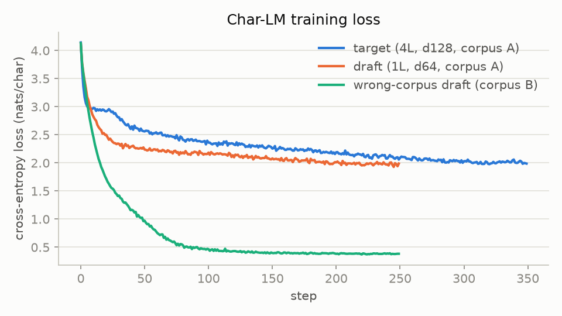
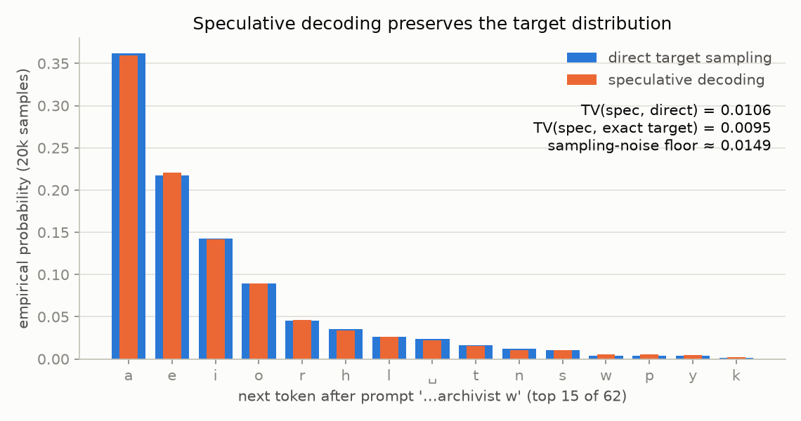
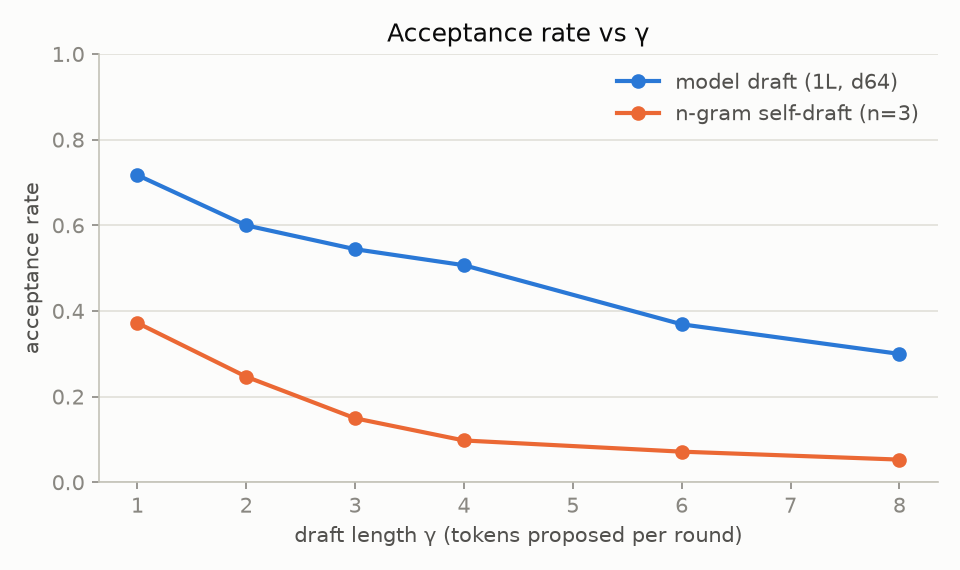
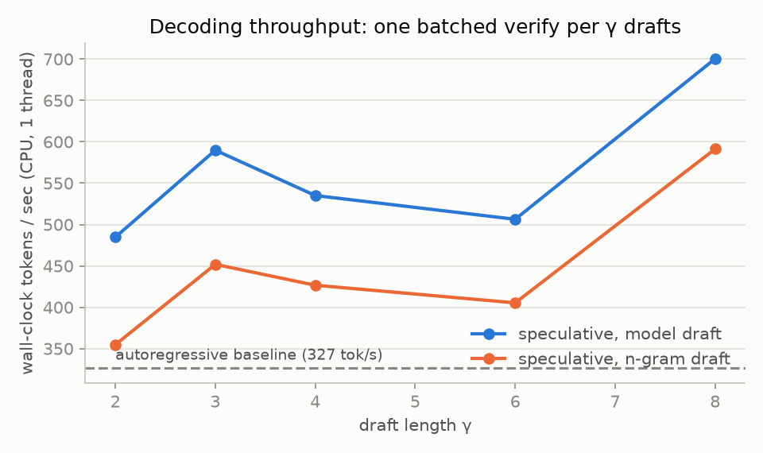
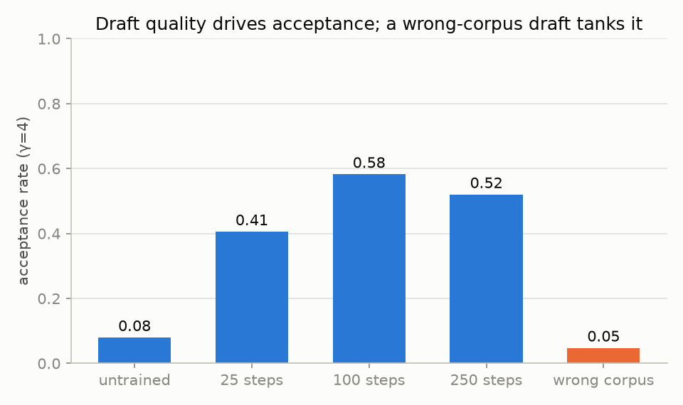
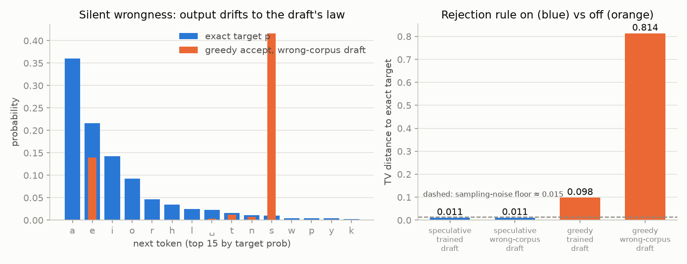

# Speculative Decoding

> Project 10 of 34 — [Step-By-Step LLM Engineering Projects (2026 Edition)](https://x.com/TheAhmadOsman/status/2058745340895870985) by [@TheAhmadOsman](https://x.com/TheAhmadOsman)
>
> **Part VI: Decoding Turns Probabilities Into Text**

## Goal

Accelerate sequential autoregressive decoding with a smaller draft model whose proposals a larger model verifies, preserving the target distribution. Study Medusa-style extra decoding heads and lookahead decoding variants that drop the separate draft model.

## The project loop

1. **Build it.** Implement the core idea yourself before using the library version.
2. **Plot it.** Loss curves, latency curves, memory curves, attention heatmaps, routing histograms, entropy plots, or failure galleries.
3. **Break it.** Ablate the thing you just built and watch what changes.
4. **Explain it.** A short technical note: what you expected, what happened, what surprised you, what you'd try next.

## Artifacts to ship

- [x] **Implementation** — clean code with tests (`speculative_decoding/`, 19 pytest tests)
- [x] **Notebook** — one reproducible experiment (`demo.py` runs the whole thing end to end, fixed seeds)
- [x] **Plots** — at least three charts showing behavior (six, in `plots/`)
- [x] **Failure gallery** — examples where the system breaks (greedy-accept + wrong-corpus draft)
- [x] **Write-up** — what I learned and what changed my mind (below)

---

## What was built

- **Two char-level transformers** trained on the same self-written ~50KB corpus (hand-written sentence templates about a harbour town, expanded deterministically): a **target** (4 layers, d128, ~828k params) and a **draft** (1 layer, d64, ~68k params). A third draft is trained on a deliberately alien pseudo-code corpus for the break-it experiment.
- **Baseline**: standard KV-cached autoregressive sampling — one target forward per token.
- **Speculative loop** (`speculative_decoding/decoding.py`): the draft proposes γ tokens (returning the exact distributions q_i it sampled from), the target verifies all of them in **one batched forward**, token i is accepted with prob `min(1, p_t(x)/q(x))`, on rejection the emitted token is resampled from the normalized positive residual `(p_t − q)+`, and when all γ are accepted a **bonus token** is sampled from the target's (γ+1)-th distribution. Both KV caches are trimmed back to the accepted prefix each round.
- **Self-drafting variant** (`NgramDrafter`): Medusa/lookahead-spirit drafting with **no second model** — proposals come from an n-gram table over the target's own committed context, backing off to shorter orders and finally the context unigram, so every proposal is a continuation seen in context. The same rejection rule makes it exact regardless of how bad q is.

## Results

*(run: `python demo.py`; all numbers below from the committed run, fixed seeds, CPU)*



Char-LM losses for the three models. The 4-layer target (828k params) and the 1-layer draft (67k params) land at almost the same loss (~2.0 nats/char) on this easy templated corpus — which is exactly why acceptance rates come out high. The wrong-corpus draft reaches 0.38 nats/char on its trivially predictable pseudo-code: a very good model of the wrong distribution.



**The correctness plot.** Empirical next-token distribution after a fixed prompt: 20k speculative samples (draft proposes, target verifies with the rejection rule) laid over 20k direct target samples. TV(spec, direct) = **0.0106** and TV(spec, exact target) = **0.0095** — both *below* the ≈0.0149 sampling-noise floor measured between two independent 20k direct-sample histograms, i.e. statistically indistinguishable from sampling the target itself. A 2000-run cross-check driving the full loop with real model calls lands at TV 0.039, consistent with its own (larger) noise floor.



Per-token acceptance falls as γ grows, because later proposals are conditioned on the draft's own earlier guesses: 0.72 → 0.30 for the model draft as γ goes 1 → 8, while the n-gram self-drafter starts at 0.37 and fades to 0.05. Free proposals, but mostly wasted ones.



Wall-clock throughput (single thread, min of 5 reps): the autoregressive baseline does **327 tok/s**; speculative decoding with the model draft does **485–700 tok/s (1.5–2.1×)** and the n-gram self-drafter **355–591 tok/s (1.1–1.8×)** across γ=2–8. Every γ beats the baseline because one batched verify of γ+1 positions costs barely more than one single-token forward at this scale. The curve is not monotone: this run shared a 16-core box with other jobs, so treat differences between neighbouring γ as noise and the gap to the baseline as the signal.



Acceptance at γ=4 versus draft quality: 0.08 for an untrained draft, 0.41 after 25 steps, ~0.5–0.58 once trained. The wrong-corpus draft (orange) is at **0.05 — worse than an untrained one**: a confidently wrong q is worse than a near-uniform ignorant one, because it concentrates its proposals exactly where the target puts no mass.



**Break-it #1: greedy-accept-everything.** Left: with the rejection rule skipped, the emitted next-token law is simply the draft's — the wrong-corpus draft dumps ~0.42 of its mass on `s` (the start of `skip;`). Right: with the rule ON, TV to the target stays at the noise floor **no matter how bad the draft is** (0.011 for both drafts); with it OFF, TV drifts to 0.098 (trained draft) and 0.814 (wrong-corpus draft). Nothing crashes, no loss spikes — the output just quietly stops being the target model's. That is the classic silent-wrongness bug.

## Failure gallery

- **Greedy-accept-everything** (skip the rejection rule, keep everything the draft proposes): the output distribution silently drifts to the *draft's* law — invisible in logs because every sample still "looks like text". TV to the target jumps from the 0.015 noise floor to **0.098** with the trained draft and **0.814** with the wrong-corpus one (`plots/breakit_greedy_accept.png`).
- **Draft trained on a different corpus** (pseudo-code instead of prose): acceptance at γ=4 collapses to **0.047 — below even an untrained draft's 0.079** (`plots/draft_quality.png`). Speculative decoding still produces exactly the target distribution (TV 0.011, at the noise floor — the rejection rule doesn't care where q comes from), but the speed win evaporates: nearly every round pays γ draft forwards plus a verify to commit ~1 token.

## Write-up

**Expected**: the rejection rule to preserve the target distribution exactly, acceptance to fall with γ, and a modest CPU speedup from amortizing per-forward overhead over γ+1 verified positions.

**Happened**: all of it, measurably. The 20k-sample check puts speculative output *below* the sampling-noise floor of direct sampling (TV 0.0106 vs floor 0.0149); acceptance decays 0.72→0.30 over γ=1→8; each batched verify commits ~2.5–3.7 tokens per target forward (110 tokens in 30 target forwards at γ=4), giving a 1.5–2.1× wall-clock speedup. Throughput keeps rising up to γ=8 even as acceptance falls, because on CPU a wider verify is almost free; on a GPU-bound target the optimum would sit lower.

**Surprised me**: three things. (1) A *confidently wrong* draft is worse than an *untrained* one — the wrong-corpus draft's acceptance (0.047) undercuts the untrained draft's (0.079), because a near-uniform q keeps min(1, p/q) reasonable on high-p tokens while a sharp wrong q proposes only tokens with p≈0. (2) How good greedy-accept looks from the inside: with the trained draft its TV is "only" 0.098 — the text stays plausible, which is exactly what makes the bug silent in production. (3) The n-gram self-drafter is worth having at all: its acceptance is poor (0.25–0.37 at small γ) but proposals cost ~nothing, so it still beats the baseline at small γ — lookahead decoding in miniature.

**Try next**: real Medusa heads (extra output heads trained on the frozen target trunk) instead of the n-gram table; tree-structured drafts verified with one attention-masked forward; measuring how acceptance varies with target entropy per position (it should tank exactly where the target is uncertain).

## Quickstart

```bash
pip install torch numpy scipy matplotlib pytest
python demo.py     # trains both models, runs all experiments, writes plots/
pytest             # 19 tests: rejection rule, residuals, chi-square exactness,
                   # KV bookkeeping after partial rejection, n-gram properties, determinism
```

---

*Status: built — implementation, tests, demo, plots and break-it experiments all committed.*
